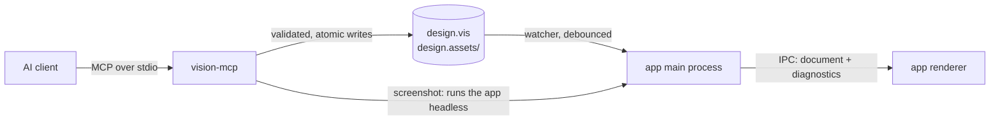

# Architecture

Vision is two programs that share one TypeScript package and nothing else at runtime: the desktop app, which draws a `.vis` file and redraws it on every save, and `vision-mcp`, which AIs use to edit it.



## Repository

| Path              | Package           | Role                                                                                                                                               |
| ----------------- | ----------------- | -------------------------------------------------------------------------------------------------------------------------------------------------- |
| `packages/format` | `@vision/format`  | The `.vis` schema, parsing, validation, deterministic serialization, tokens → Tailwind theme, HTML → nodes, edit operations. No Electron or React. |
| `packages/mcp`    | `@vision/mcp`     | The `vision-mcp` stdio server: MCP tools over `@vision/format`.                                                                                    |
| `apps/desktop`    | `@vision/desktop` | The Electron app.                                                                                                                                  |

Dependencies point one way: `desktop → format` and `mcp → format`. The desktop app and the MCP server never import each other; the only runtime link is the `screenshot` tool launching the app.

## Desktop app

```
apps/desktop/src/
  main/       lifecycle, windows, native menu, IPC handlers, file watching, recent files, asset protocol, screenshot mode
  preload/    the typed bridge exposed as window.vision
  shared/     the IPC contract: channel names, zod schemas, types
  renderer/   React UI
    app/          root, routing between start and design views, global shortcuts
    features/     start, sidebar, toolbar, canvas, problems, app-menu, connect-ai
    design/       Tailwind runtime compiler and the node → DOM renderer
    ui/           primitives: Button, IconButton, Menu, Tooltip, Kbd
```

- **Security.** `contextIsolation`, `sandbox` and a strict CSP are on, and `nodeIntegration` is off. The renderer reaches the system only through `window.vision`, and main validates every IPC payload with zod. Navigation and new windows are blocked.
- **One file per window** ([ADR 003](decisions/003-one-file-per-window.md)). Main keeps a registry from file path to window, so opening a file that's already open focuses its window.
- **Watching.** Main watches the file's folder, so saves that rename a temp file over the original are seen, and debounces events. Each change is read, parsed and validated in main, then sent to the renderer as `{ document, diagnostics, status }`. When the new version has errors, `document` stays the last valid one.
- **Drawing** ([ADR 002](decisions/002-tailwind-in-sandboxed-iframes.md)). The renderer compiles Tailwind CSS at runtime for the classes in the document, with the tokens as theme variables. Each artboard is an `<iframe sandbox="allow-same-origin">` sized to the artboard, so responsive variants follow its width, its styles can't leak into the app, and nothing inside it can run scripts. React renders the nodes into each iframe through a portal.
- **Assets.** Images load through a privileged `vision-asset://` protocol that serves only files inside the open design's assets folder.
- **Canvas.** Artboards are placed by their `x`/`y` on a transformed layer. Pan with scroll or drag, and zoom with pinch, ⌘-scroll or the toolbar.

## MCP server

- Every tool takes the `.vis` path ([ADR 004](decisions/004-mcp-tools-take-the-file.md)), so one registration serves every design.
- **Writes** go through `@vision/format`:
  1. Read the file; a missing file is an empty design.
  2. Apply the edit in memory.
  3. Validate, and reject the edit if it adds an error the file didn't already have.
  4. Serialize deterministically to a temp file, then rename it over the original.
- `screenshot` runs the installed Vision app with `--screenshot`. The app renders the artboard in a hidden window, writes a PNG and exits, so screenshots match what people see.
- The packaged app ships the server as a script run by the app's own binary with `ELECTRON_RUN_AS_NODE=1`, so users need no separate Node install.
