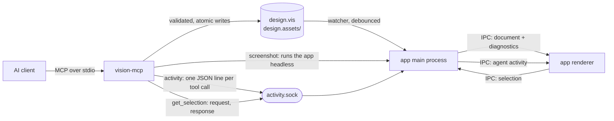

# Architecture

Vision is two programs that share TypeScript packages and talk only through the design file and a local socket: the desktop app, which draws a `.vis` file and redraws it on every save, and `vision-mcp`, which AIs use to edit it.



## Repository

| Path                | Package            | Role                                                                                                                                               |
| ------------------- | ------------------ | -------------------------------------------------------------------------------------------------------------------------------------------------- |
| `packages/format`   | `@vision/format`   | The `.vis` schema, parsing, validation, deterministic serialization, tokens → Tailwind theme, HTML → nodes, edit operations. No Electron or React. |
| `packages/activity` | `@vision/activity` | The socket protocol: agent activity messages, selection requests and responses, the socket path and client, display names for MCP clients.         |
| `packages/mcp`      | `@vision/mcp`      | The `vision-mcp` stdio server: MCP tools over `@vision/format`.                                                                                    |
| `apps/desktop`      | `@vision/desktop`  | The Electron app.                                                                                                                                  |

Dependencies point one way: `desktop → format, activity` and `mcp → format, activity`. The desktop app and the MCP server never import each other; at runtime they meet only through the `screenshot` tool launching the app and the activity socket. Layer labels (`layerLabel`) live in `@vision/format`, so the layer list and `get_selection` name layers the same way.

## Desktop app

```
apps/desktop/src/
  main/       lifecycle, windows, native menu, IPC handlers, file watching, recent files, asset protocol, screenshot and review modes
  preload/    the typed bridge exposed as window.vision
  shared/     the IPC contract: channel names, zod schemas, types
  renderer/   React UI
    app/          root, routing between start and design views, global shortcuts
    features/     start, sidebar, toolbar, canvas, layers, problems, app-menu, connect-ai, agents, review
    design/       Tailwind runtime compiler and the node → DOM renderer
    components/   ui/: shadcn/ui components on Base UI (owned, restyled); Icon, IconButton
    hooks/        shared React hooks
```

- **Interface** ([ADR 006](decisions/006-shadcn-ui-on-base-ui.md)). The app's own controls are shadcn/ui components on Base UI, imported as `@/components/ui/<name>`; [App UI](ui.md#components) lists them.
- **Security.** `contextIsolation`, `sandbox` and a strict CSP are on, and `nodeIntegration` is off. The renderer reaches the system only through `window.vision`, and main validates every IPC payload with zod. Navigation and new windows are blocked. The CSP, not the SVG sanitizer, is what limits what a design can load: scripts only from the app, and images only from the app, `vision-asset:`, `data:`, `blob:` and `https:`. Remote `https:` images are allowed by design, so opening a design can make requests to the hosts it names.
- **One file per window** ([ADR 003](decisions/003-one-file-per-window.md)). Main keeps a registry from file path to window, so opening a file that's already open focuses its window.
- **Watching.** Main watches the file's folder, so saves that rename a temp file over the original are seen, and its assets folder, so added or changed images redraw; it debounces events. Each change is read, parsed and validated in main, then sent to the renderer as `{ document, diagnostics, status }`. When the new version has errors or can't be read (`read-error`, with the reason), `document` stays the last valid one. A file that can't be read when it's opened isn't opened, and the error is shown.
- **Drawing** ([ADR 002](decisions/002-tailwind-in-sandboxed-iframes.md)). The renderer compiles Tailwind CSS at runtime for the classes in the document, with the tokens as theme variables. Each artboard is an `<iframe sandbox="allow-same-origin">` sized to the artboard, so responsive variants follow its width, its styles can't leak into the app, and nothing inside it can run scripts. React renders the nodes into each iframe through a portal.
- **Redrawing.** Main sends the whole document on every save. The renderer keeps the objects of pages, artboards and nodes that didn't change (matched by id), so React re-renders only the changed artboards and nodes. Classes are collected per artboard: Tailwind recompiles only when the set of classes or the tokens change, and an artboard keeps its stylesheet while that one still has every class it uses, since swapping an iframe's stylesheet restyles its whole document.
- **Fonts.** The app ships 14 open-licensed variable font families as Latin woff2 files in its renderer bundle (about 1.3 MB, from `@fontsource-variable` packages), listed in `design/fonts.ts`. When a `font` token names one, the Tailwind engine puts its `@font-face` rules, pointing at the app's own files, in front of the artboard's stylesheet, so designs draw the same on every machine and in screenshot and review modes, with no network; the CSP's `font-src 'self'` stays as it is. [Fonts](format.md#fonts) lists them.
- **Assets.** Images load through a privileged `vision-asset://` protocol that serves only files inside the open design's assets folder.
- **Canvas.** Artboards are placed by their `x`/`y` on a transformed layer. Pan with scroll or drag, and zoom with pinch, ⌘-scroll or the toolbar.
- **Culling.** Only artboards within 600 screen px of the canvas get an iframe, plus the one holding the selection and the ones an agent is on, so a zoomed-in view keeps the DOM and style work of a few artboards. Artboards that come into view mount one per frame, nearest the middle first, so zooming out stays responsive; artboards that leave it unmount once the viewport has been still for 500 ms, so panning back and forth doesn't rebuild them. The viewport never moves for culling. Code that needs a drawn element (outlines, zoom to layer, reveals, the agent cursor) finds it only in drawn artboards; the selection's artboard is always drawn, so zoom to layer can measure it. An agent's artboard is drawn as soon as its activity message arrives; an edit drawn before that has no reveal, and a cursor aimed at a node that isn't drawn points at the artboard's name.
- **Layers.** The sidebar's layer tree renders only expanded rows. Hover and selection outlines are drawn in the app above the iframes, never inside a design: the renderer finds an element by `data-node-id` in its artboard's iframe, reads its box in artboard pixels and maps it through the viewport. A canvas click hit-tests with the iframe document's `elementFromPoint`, since the iframes themselves ignore the pointer. The selection is kept per window in a zustand store, survives saves while its id exists and is cleared on page switches.

## Review mode

The app reviews a design as it draws it ([ADR 008](decisions/008-review-designs-as-the-app-draws-them.md)), so findings match what people see. [Design review](review.md) lists the rules and the score.

1. `--vision-review=<file.vis> --out=<file.json> [--artboard=<id>]`, one argument per option as in screenshot mode, opens an offscreen window that draws every artboard, or the one given, in its own iframe.
2. Once fonts and images have settled, the renderer measures each node and each artboard's root: its box in artboard pixels, client and scroll sizes, and the computed styles the rules use. Colors are painted on a canvas to read them as sRGB, since computed colors can be `oklch()`; margins come from the computed value, so `auto` isn't read as pixels.
3. Main validates the measurements with zod, runs `reviewDesign` from `@vision/format` and writes the report as JSON. Every failure exits with code 1 and one line on stderr.

## MCP server

- Every tool takes the `.vis` path ([ADR 004](decisions/004-mcp-tools-take-the-file.md)), so one registration serves every design.
- **Writes** go through `@vision/format`:
  1. Read the file; a missing file starts as a new design with page `page-1` and a 1440×900 artboard `desktop`.
  2. Apply the edit in memory.
  3. Validate, and reject the edit if it adds an error the file didn't already have.
  4. Serialize deterministically to a temp file beside the real file (following a symlink, keeping its permissions), then rename it over the original. If the file changed since step 1, the edit is rejected instead.
- **Icons** ([ADR 010](decisions/010-icons-by-name-expanded-on-write.md)). `write_html` turns `<i data-icon="name">` into an `svg` node holding that Hugeicons icon's markup, through a resolver it passes to `htmlToNodes`; `@vision/format` itself knows no icon set. `find_icons` searches the names.
- `screenshot` runs the Vision app with `--vision-screenshot=<file.vis> --artboard=<id> --out=<file.png> [--scale=<n>]`. Each option is one argument, so a value can never be read as a Chromium switch. The server lowers the scale (to a fraction if needed) so the PNG's longest side is at most 2000 px, the most AI clients accept. The app renders the artboard in an offscreen window (so artboards taller than the screen work), waits for the first frame that shows a marker pixel the page paints below the artboard once it has drawn, writes the PNG and exits, so screenshots match what people see. Its profile (`--user-data-dir`) sits in the server's temp folder, which the server removes afterwards. Every failure exits with code 1 and one line on stderr. [How the server finds the app](../packages/mcp/README.md#screenshots).
- The packaged app ships the server at `Contents/Resources/mcp/vision-mcp.mjs`, run by the app's own binary with `ELECTRON_RUN_AS_NODE=1`, so users need no separate Node install. [Releasing](releasing.md) explains the fuses that allow it.

## Agent activity

While an AI works, the app shows its cursor, a status in the top bar and new elements appearing in turn ([ADR 005](decisions/005-agent-activity-over-a-local-socket.md)).

- **Server.** After each tool call, `vision-mcp` sends `{ v, session, agent, file, at, activity }` to the socket. `activity` is `edit` (the touched node ids, from `diffDocuments` before and after the write), `look` (reading or a screenshot) or `done` (sent when stdin closes). `agent` is the client's display name from `clientInfo`, such as "Claude Code".
- **Main.** `ActivityServer` validates each line, resolves `file` to its real path and forwards the message to that file's window. A connection that closes sends `done` for its sessions.
- **Renderer.** On every save, the renderer diffs the artboards that changed and lists the touched nodes in reading order (a frame before its children). A save belongs to the session whose last `edit` named one of its nodes; `AgentPlayback` plays it in that session's queue (paced playback, below), and plays saves no agent claims, such as a person's, within 1.5 s. Elements are found by `data-node-id` in each artboard's iframe and toggled with `data-reveal`. `AgentTracker` moves each session's cursor to the element being shown, or to the artboard's name for a `look`, and switches the status to "is thinking" when the session's queue is empty. Everything is keyed by session, so two agents get two cursors and two queues.

### Paced playback

An AI writes a whole section per tool call and takes 5–30 s to write it, so edits arrive as rare bursts. The app plays each burst element by element over about the time the agent takes to write the next one, like a video buffer, so the canvas keeps moving and the cursor glides instead of racing ([ADR 009](decisions/009-play-agent-edits-at-the-agents-pace.md)).

| Rule                            | Value                                                                                                                                                  |
| ------------------------------- | ------------------------------------------------------------------------------------------------------------------------------------------------------ |
| Budget of a batch               | 1.5 × the longer of the session's last edit-to-edit gap and its smoothed gap (moving average, weight 0.5), between 1.5 and 15 s. The first batch: 3 s. |
| Step                            | The budget spread over the waiting elements, kept 40–600 ms apart.                                                                                     |
| A batch arrives while one plays | The waiting elements and the new batch share the new budget; waiting elements only ever speed up, so playback stays at most about one batch behind.    |
| `done`, pan, zoom, select, page | The rest of every affected queue shows within 300 ms, so the screen matches the file.                                                                  |
| Idle                            | Nothing to do: a queue empties within its last budget (at most 15 s, or 40 ms an element for huge batches), well before the 60 s idle timeout.         |
| Reduced motion                  | No playback: every save shows at once, and the cursor jumps.                                                                                           |
| Artboard not drawn              | No playback for it; it shows complete once it's drawn. The artboard the cursor plays on stays drawn.                                                   |

Waiting elements keep their full layout and only have `opacity: 0` (`data-reveal="hidden"`), so the artboard fills in instead of reflowing; a redraw hides waiting elements again. The layer tree, selection, screenshots and review read the file and the DOM, not the playback, so they're unaffected. To see playback, replay a recorded session: [Measure performance](performance.md#replay-an-ai-session).

## Selection

AIs can ask which layer the user selected ([ADR 007](decisions/007-share-the-selection-over-the-activity-socket.md)).

1. Whenever the selection or the page changes, the renderer sends `{ pageId, nodeIds }` to main over IPC; main validates it and keeps it per window.
2. `get_selection` connects to the activity socket and writes `{ v, id, request: "selection", file }`.
3. `ActivityServer` resolves `file` to its real path and answers on the same connection with `{ v, id, response }`: `not-open`, or `open` with the window's selection. The answer holds only ids; the server never reads files for a request.
4. The tool reads the file itself, describes each selected layer, and reports a `look` activity with the node id, so the app's cursor points at it. It waits at most one second and says so when Vision isn't running, the file isn't open or nothing is selected.
